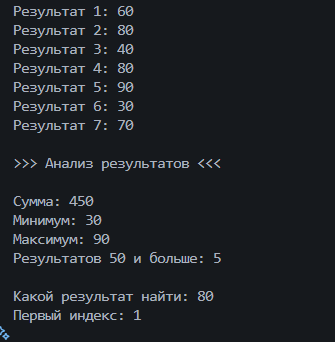

# Практическая работа №17

Автор: Михальчук 
Группа: ИСП-254

## Тема

Алгоритмы обработки массивов.

## Что реализовано

- сумма элементов;
- подсчёт элементов по условию;
- минимум и максимум;
- линейный поиск;
- поиск первого индекса.

## Короткие ответы

1. Почему максимум нельзя всегда начинать с `0`?

Ответ: Если все числа отрицательные начальный 0 окажется больше них и метод вернёт число, которого нет в массиве.

2. Что означает `-1` после поиска индекса?

Ответ: Значение в массиве не найдено.

3. Чем сумма отличается от подсчёта элементов?

Ответ: Сумма складывает значения элементов а подсчёт прибавляет по 1 за каждый подходящий элемент.

## Результат

